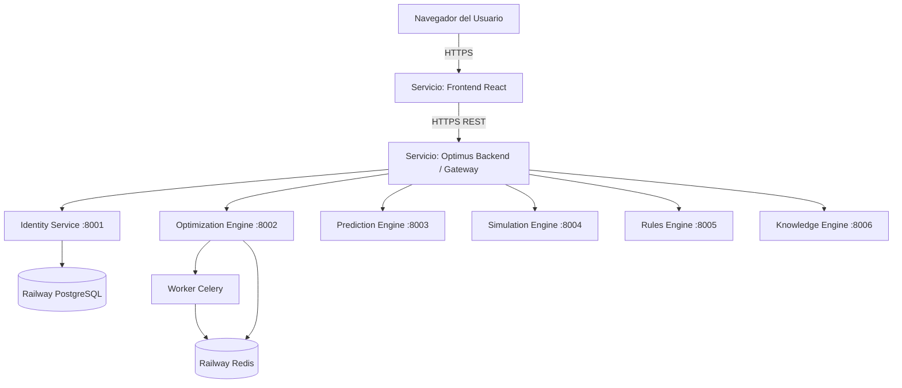

# Guía Definitiva de Despliegue en Railway — OptimusAI / SuperERP 🚀

Esta guía contiene el instructivo **paso a paso** para desplegar la plataforma completa de **SuperERP (OptimusAI)** en [Railway](https://railway.app), incluyendo el Frontend interactivo (React 19 + Vite), el API Gateway, la base de datos PostgreSQL, la memoria caché/broker Redis y todos los motores de inteligencia artificial y optimización matemática.

---

## 🗺️ Índice
1. [Arquitectura y Opciones de Despliegue](#-arquitectura-y-opciones-de-despliegue)
2. [Requisitos Previos](#-requisitos-previos)
3. [Opción A: Despliegue Rápido y Económico (Recomendado)](#-opción-a-despliegue-rápido-y-económico-recomendado)
   - [Paso 1: Crear Proyecto en Railway](#paso-1-crear-proyecto-en-railway)
   - [Paso 2: Agregar PostgreSQL y Redis](#paso-2-agregar-postgresql-y-redis)
   - [Paso 3: Desplegar el Backend Unificado](#paso-3-desplegar-el-backend-unificado)
   - [Paso 4: Desplegar el Frontend](#paso-4-desplegar-el-frontend)
   - [Paso 5: Vincular Frontend con Backend](#paso-5-vincular-frontend-con-backend)
4. [Opción B: Despliegue en Microservicios Puros](#-opción-b-despliegue-en-microservicios-puros)
5. [Verificación y Credenciales de Acceso](#-verificación-y-credenciales-de-acceso)
6. [Resolución de Problemas Comunes (Troubleshooting)](#-resolución-de-problemas-comunes-troubleshooting)

---

## 🏗️ Arquitectura y Opciones de Despliegue

Railway ofrece dos formas de desplegar esta arquitectura:

| Característica | Opción A: Backend Unificado (Recomendada) | Opción B: Microservicios Puros |
| :--- | :--- | :--- |
| **Consumo de Memoria** | ~450 MB RAM total | ~2.5 GB RAM total |
| **Costo estimado en Railway** | **$0 a $5/mes** (cubre con crédito inicial) | Requiere plan pago con mayor cuota |
| **Servicios en Railway** | 4 (Postgres, Redis, Backend, Frontend) | 10+ servicios individuales |
| **Complejidad de configuración** | **Muy simple (10 minutos)** | Alta (configurar networking de 8 servicios) |
| **Uso ideal** | Demos, producción inicial, staging | Alta concurrencia, escalado horizontal |

---

## 📋 Requisitos Previos

1. Una cuenta activa en [Railway.app](https://railway.app/) (puedes ingresar con tu cuenta de GitHub).
2. Tener el repositorio subido a tu cuenta de GitHub (por ejemplo `kevinKfv/supererp` o tu propio fork/repo).

---

## 🚀 Opción A: Despliegue Rápido y Económico (Recomendado)

Esta opción utiliza el archivo [`optimus-ai/Dockerfile.railway`](file:///c:/Users/jazmin/.gemini/antigravity-ide/scratch/supererp/optimus-ai/Dockerfile.railway) que preparamos para correr todos los motores (Identidad, Optimización, Predicción, Simulación, Reglas, Knowledge Engine y Celery Worker) bajo un único API Gateway eficiente.

---

### Paso 1: Crear Proyecto en Railway

1. Ingresa a [railway.app](https://railway.app) e inicia sesión con GitHub.
2. En tu Dashboard, haz clic en el botón **"+ New Project"**.
3. Selecciona la opción **"Empty Project"** (o "Provision PostgreSQL" directamente).

---

### Paso 2: Agregar PostgreSQL y Redis

#### 2.1 Agregar PostgreSQL:
1. Dentro de tu proyecto en Railway, haz clic en **"+ Create"** o presiona `Ctrl + K`.
2. Selecciona **"Database"** ➡️ **"Add PostgreSQL"**.
3. Railway aprovisionará la base de datos en pocos segundos.
4. Haz clic sobre el servicio PostgreSQL, ve a la pestaña **"Variables"** y copia el valor de `DATABASE_URL` (se usará automáticamente o mediante referencia `${{Postgres.DATABASE_URL}}`).

#### 2.2 Agregar Redis:
1. Haz clic nuevamente en **"+ Create"** o `Ctrl + K`.
2. Selecciona **"Database"** ➡️ **"Add Redis"**.
3. Railway levantará la instancia de Redis y creará la variable `REDIS_URL`.

---

### Paso 3: Desplegar el Backend Unificado

1. En el mismo proyecto, haz clic en **"+ Create"** ➡️ **"GitHub Repo"**.
2. Selecciona tu repositorio (ej. `supererp`).
3. Railway creará un servicio conectado a tu repositorio. Haz clic en él para configurarlo antes del primer build:
4. Ve a la pestaña **"Settings"**:
   - **Service Name:** Cambia el nombre a `optimus-backend`.
   - **Root Directory:** déjalo vacío o pon `/` (la raíz del repositorio).
   - **Build:**
     - En **"Builder"**, selecciona **`DOCKERFILE`**.
     - En **"Dockerfile Path"**, escribe: **`optimus-ai/Dockerfile.railway`**.
5. Ve a la pestaña **"Variables"** y agrega:
   - `DATABASE_URL`: Haz clic en **"Add Reference"** y selecciona `${{Postgres.DATABASE_URL}}` (o pega la URL de PostgreSQL).
   - `REDIS_URL`: Haz clic en **"Add Reference"** y selecciona `${{Redis.REDIS_URL}}` (o pega la URL de Redis).
   - `SECRET_KEY`: Escribe una clave aleatoria segura (ej. `super-secret-key-enterprise-production-2026`).
6. Generar Dominio Público:
   - En la pestaña **"Settings"**, ve a la sección **"Networking"**.
   - Haz clic en **"Generate Domain"** (Railway te asignará una URL como `optimus-backend-production.up.railway.app`).
   - ⚠️ **Copia esta URL**, la necesitarás en el paso del Frontend.
7. Haz clic en **"Deploy"** o guarda los cambios. Railway construirá la imagen Docker e iniciará todos los servicios.

> [!TIP]
> **Usuario Administrador Automático:** El backend tiene configurado el autosembrado automático. Al arrancar creará el usuario administrador `admin_supererp` con contraseña `SuperSecretPassword123` en PostgreSQL de manera inmediata.

---

### Paso 4: Desplegar el Frontend

1. Haz clic nuevamente en **"+ Create"** ➡️ **"GitHub Repo"** y selecciona el mismo repositorio `supererp`.
2. Haz clic en el nuevo servicio que se creó y ve a la pestaña **"Settings"**:
   - **Service Name:** Cambia el nombre a `optimus-frontend`.
   - **Root Directory:** Escribe: **`optimus-ai/frontend`**.
   - **Build:** Railway detectará automáticamente Node/Vite (Nixpacks) o puedes usar el Dockerfile de producción:
     - Si usas Dockerfile: En **"Dockerfile Path"** coloca `optimus-ai/frontend/Dockerfile.prod`.
3. Ve a la pestaña **"Variables"** y agrega:
   - `VITE_API_URL`: Pega la URL pública que copiaste del backend en el Paso 3.6 (ejemplo: `https://optimus-backend-production.up.railway.app`). **¡Asegúrate de incluir `https://` y no dejar barra final!**
4. Generar Dominio Público para el Frontend:
   - En la pestaña **"Settings"** ➡️ sección **"Networking"**.
   - Haz clic en **"Generate Domain"** (ejemplo: `optimus-frontend-production.up.railway.app`).
5. Haz clic en **"Deploy"**. Railway compilará el frontend con Vite inyectando la URL de tu API y lo publicará.

---

### Paso 5: Vincular Frontend con Backend

¡Listo! Abre el dominio público generado para el frontend en tu navegador (ej. `https://optimus-frontend-production.up.railway.app`).

---

## 🧩 Opción B: Despliegue en Microservicios Puros

Si prefieres tener cada contenedor separado individualmente en Railway:

1. **Crear Bases de Datos:**
   - Crear PostgreSQL y Redis tal como se explicó en el Paso 2.
2. **Crear los Servicios Backend uno a uno:**
   Para cada servicio, haz clic en **"+ Create" ➡️ "GitHub Repo"**:
   
   | Nombre del Servicio | Root Directory | Dockerfile Path | Variables de Entorno Necesarias |
   | :--- | :--- | :--- | :--- |
   | `identity-service` | `optimus-ai/services/identity-service` | `Dockerfile` | `DATABASE_URL=${{Postgres.DATABASE_URL}}` |
   | `optimization-engine` | `optimus-ai/services/optimization-engine` | `Dockerfile` | `REDIS_URL=${{Redis.REDIS_URL}}` |
   | `optimization-worker` | `optimus-ai/services/optimization-engine` | `Dockerfile` | `REDIS_URL=${{Redis.REDIS_URL}}`  *(Start Command: `celery -A app.worker:celery_app worker --loglevel=info`)* |
   | `prediction-engine` | `optimus-ai/services/prediction-engine` | `Dockerfile` | *(Opcional: MINIO_URL si añades MinIO)* |
   | `simulation-engine` | `optimus-ai/services/simulation-engine` | `Dockerfile` | Ninguna requerida |
   | `rules-engine` | `optimus-ai/services/rules-engine` | `Dockerfile` | Ninguna requerida |
   | `knowledge-engine` | `optimus-ai/services/knowledge-engine` | `Dockerfile` | Ninguna requerida |
   
3. **Crear el Gateway:**
   - **Root Directory:** `optimus-ai/services/gateway-service`
   - **Dockerfile Path:** `Dockerfile`
   - **Networking:** Haz clic en **"Generate Domain"** para obtener su URL pública.
   - **Variables:** Configurar las URLs privadas de Railway usando el formato interno:
     - `IDENTITY_SERVICE_URL`: `http://${{identity-service.RAILWAY_PRIVATE_DOMAIN}}:8000`
     - `OPTIMIZATION_ENGINE_URL`: `http://${{optimization-engine.RAILWAY_PRIVATE_DOMAIN}}:8000`
     - `PREDICTION_ENGINE_URL`: `http://${{prediction-engine.RAILWAY_PRIVATE_DOMAIN}}:8000`
     - `SIMULATION_ENGINE_URL`: `http://${{simulation-engine.RAILWAY_PRIVATE_DOMAIN}}:8000`
     - `RULES_ENGINE_URL`: `http://${{rules-engine.RAILWAY_PRIVATE_DOMAIN}}:8000`
     - `KNOWLEDGE_ENGINE_URL`: `http://${{knowledge-engine.RAILWAY_PRIVATE_DOMAIN}}:8000`

4. **Crear el Frontend:**
   - **Root Directory:** `optimus-ai/frontend`
   - **Variables:** `VITE_API_URL` apuntando a la URL pública del `gateway-service`.

---

## 🔑 Verificación y Credenciales de Acceso

Una vez desplegado:

### 1. Probar el Inicio de Sesión
1. Entra a la URL pública de tu frontend.
2. Serás redirigido a la pantalla de **Login**.
3. Haz clic en el botón de conveniencia **"Auto-completar Credenciales Demo"** o escribe:
   - **Usuario:** `admin_supererp`
   - **Contraseña:** `SuperSecretPassword123`
4. Haz clic en **"Iniciar Sesión"**. Entrarás al Dashboard principal con el token JWT activo.

### 2. Probar los Motores
- **Optimización (`/optimization`):** Carga un preset o edita la matriz y pulsa *"Calcular Asignación Óptima"*. Se ejecutará el solver de Google OR-Tools a través de Celery y Redis.
- **Predicción (`/prediction`):** Ajusta los deslizadores de precio, marketing y temperatura, y pulsa *"Generar Predicción"*. El modelo XGBoost responderá inmediatamente.
- **Simulación (`/simulation`):** Ejecuta el análisis de riesgo de Monte Carlo con 10,000 iteraciones.
- **Reglas (`/rules`):** Evalúa las condiciones JSON dinámicas.
- **Asistente NLP (`/chat`):** Envía *"Reducir los costos un 15%"* y revisa la respuesta de XAI (Explainable AI).

---

## 🛠️ Resolución de Problemas Comunes (Troubleshooting)

### 1. El Frontend da error "No se pudo conectar con el servidor"
- **Causa:** La variable `VITE_API_URL` no está definida o apunta a `localhost`.
- **Solución:**
  1. Ve al servicio de Frontend en Railway ➡️ pestaña **"Variables"**.
  2. Verifica que `VITE_API_URL` esté exactamente con la URL HTTPS de tu backend (ej. `https://optimus-backend-production.up.railway.app`).
  3. Realiza un **"Redeploy"** del frontend (las variables de Vite se incrustan en tiempo de compilación).

### 2. Error con PostgreSQL: `NoSuchModuleError: Can't load plugin: sqlalchemy.dialects:postgres`
- **Causa:** Railway provee la URL comenzando con `postgres://`, mientras que SQLAlchemy requiere `postgresql://`.
- **Solución:** Ya dejamos incorporado el reemplazo automático en [`database.py`](file:///c:/Users/jazmin/.gemini/antigravity-ide/scratch/supererp/optimus-ai/services/identity-service/app/infrastructure/database.py). No tienes que hacer nada adicional.

### 3. El puerto del contenedor falla al iniciar
- **Causa:** En Railway el puerto es asignado dinámicamente mediante la variable `$PORT`.
- **Solución:** Todos los Dockerfiles y uvicorn fueron actualizados para usar `${PORT:-8000}`, garantizando compatibilidad tanto en Railway como en Docker Compose local.

### 4. Celery no procesa tareas de optimización
- **Causa:** La variable `REDIS_URL` no está configurada o el servicio Redis no se ha desplegado.
- **Solución:** Verifica en las variables de tu backend que `REDIS_URL` apunte a tu plugin de Redis (`${{Redis.REDIS_URL}}`).
